# Urban Traffic Data Platform

An end-to-end, enterprise-grade **Medallion Lakehouse & Analytics Platform** designed to ingest, transform, analyze, and monitor metropolitan traffic congestion and road incidents in real time across the city of Hanoi.

[](#architecture)
[](https://airflow.apache.org/)
[](https://www.getdbt.com/)
[](https://min.io/)
[](https://www.postgresql.org/)
[](https://powerbi.microsoft.com/)

---

## 🏛️ System Architecture

The platform follows the **Medallion Architecture (Bronze &rarr; Silver &rarr; Gold)** pattern to ensure reliable data lineage, robust quality enforcement, and low-latency analytical serving.

```mermaid
flowchart LR
    subgraph INGESTION["1. Ingestion Layer"]
        API["TomTom Traffic API<br/>(City-wide Bounding Box)"] -->|"Scheduled Polling<br/>(15-min interval)"| COL["Python Collector<br/>(Backoff Retry & Audit)"]
    end

    subgraph LAKEHOUSE["2. Lakehouse Storage (MinIO S3)"]
        COL -->|"Raw Payload + Metadata"| BRONZE[("Bronze Bucket<br/>(Raw JSON Snapshots)")]
        BRONZE -->|"Clean, Cast, Deduplicate<br/>Partition by dt"| SPARK["PySpark / PyArrow<br/>Batch Processor"]
        SPARK -->|"Snappy Parquet"| SILVER[("Silver Bucket<br/>(Curated Incident Parquet)")]
    end

    subgraph WAREHOUSE["3. Data Warehouse & Marts (PostgreSQL)"]
        SILVER -->|"Idempotent Upsert<br/>ON CONFLICT DO NOTHING"| STG[("stg_traffic_incidents<br/>(Snapshot Stage)")]
        STG -->|"dbt build & test"| DBT{"dbt Transformations<br/>(Star Schema)"}
        DBT --> DIM["dim_incident_type<br/>(SCD / Reference)"]
        DBT --> FACT["fact_traffic_incidents<br/>(Incremental Fact)"]
        DBT --> AGG["agg_hourly_incident_summary<br/>(Hourly Heatmap Rollup)"]
    end

    subgraph SERVING["4. Serving & BI"]
        FACT & AGG & DIM --> PBI["Power BI Dashboard<br/>(DirectQuery Live Maps & Trends)"]
    end

    style BRONZE fill:#cd7f32,stroke:#333,stroke-width:1px,color:#fff
    style SILVER fill:#c0c0c0,stroke:#333,stroke-width:1px,color:#000
    style GOLD fill:#ffd700,stroke:#333,stroke-width:1px,color:#000
    style INGESTION fill:#f8f9fa,stroke:#e9ecef,stroke-width:1px
    style LAKEHOUSE fill:#f1f3f5,stroke:#dee2e6,stroke-width:1px
    style WAREHOUSE fill:#f8f9fa,stroke:#e9ecef,stroke-width:1px
    style SERVING fill:#f1f3f5,stroke:#dee2e6,stroke-width:1px
```



---

## 🌟 Key Features

- **City-wide Dynamic Spatial Ingestion**: Uses geospatial bounding boxes (`bbox`) to capture 100% of incidents across urban Hanoi rather than relying on sparse point sampling.
- **Resilient Ingestion Pipeline**: Exponential backoff retry mechanism with graceful HTTP 429 quota handling and lineage audit tags (`ingestion_timestamp_utc`, `bbox_area`, `latency_ms`).
- **Medallion Lakehouse Processing**:
  - **Bronze**: Full-fidelity raw JSON preservation with zero data loss.
  - **Silver**: Cleansed, timezone-localized (`Asia/Ho_Chi_Minh`), flattened, and deduplicated Parquet partitions with automated compaction defense against small-file sprawl.
  - **Gold**: Kimball-modeled relational Data Marts with strict schema testing (`unique`, `not_null`, `accepted_values`).
- **Fully Automated Orchestration**: Managed by **Apache Airflow 2.8** running containerized DAGs on a 15-minute recurring schedule.
- **Enterprise BI Readiness**: Ready for DirectQuery connections with spatial coordinates (`latitude`, `longitude`), congestion queues (`length_km`), delay metrics (`delay_minutes`), and corridor spans (`road_from`, `road_to`).

---

## 🗂️ Repository Structure

```text
.
├── airflow/
│   └── dags/
│       └── dag_traffic_pipeline.py      # Automated Airflow ELT pipeline DAG
├── collector/
│   ├── hanoi_incident_collector.py      # City-wide incident ingestion (Bounding Box)
│   └── tomtom_collector.py              # Corridors flow segment collector
├── config/
│   ├── hanoi_area_config.json           # Geospatial bounding box definitions
│   └── hanoi_corridors.json             # Key monitored transit corridors
├── dbt/
│   ├── dbt_project.yml                  # dbt platform configuration
│   ├── profiles.yml                     # Environment-driven connection profiles
│   └── models/
│       ├── schema.yml                   # Automated data quality test suites
│       ├── sources.yml                  # Staging source definitions
│       ├── dim_incident_type.sql        # Standardized incident dimension table
│       ├── fact_traffic_incidents.sql   # Incremental fact table for road events
│       └── agg_hourly_incident_summary.sql # Spatial-temporal hourly aggregation
├── docker/
│   └── docker-compose.yml               # Multi-service stack (Postgres, MinIO, Kafka, Airflow)
├── spark/
│   └── jobs/
│       ├── bronze_to_silver_incidents.py # Bronze -> Silver Parquet transformation job
│       └── load_incidents_to_postgres.py # Silver -> PostgreSQL idempotent loader
├── docs/                                # Technical specs and architectural docs
├── .env.example                         # Environment variable template
├── requirements.txt                     # Python dependencies
└── README.md
```

---

## 📊 Data Model & Analytics Schema

The Gold Layer is organized in a dimensional schema optimized for analytical query performance:

```
                      ┌────────────────────────┐
                      │   dim_incident_type    │
                      ├────────────────────────┤
                      │ PK incident_type (INT) │
                      │    type_label (VARCHAR)│
                      │    type_group (VARCHAR)│
                      └───────────┬────────────┘
                                  │ 1
                                  │
                                  │ *
┌─────────────────────────────┐   │   ┌────────────────────────────────┐
│ agg_hourly_incident_summary │   └───┤      fact_traffic_incidents    │
├─────────────────────────────┤       ├────────────────────────────────┤
│ PK date_key (DATE)          │       │ PK fact_id (MD5 HASH)          │
│ PK hour_key (INT)           │       │    incident_id (VARCHAR)       │
│    day_of_week (INT)        │       │ FK incident_type (INT)         │
│ FK incident_type (INT)      │       │    magnitude (INT)             │
│    type_label (VARCHAR)     │       │    delay_seconds (INT)         │
│    total_incidents (INT)    │       │    delay_minutes (FLOAT)       │
│    avg_delay_minutes (FLOAT)│       │    length_km (FLOAT)           │
│    total_delay_minutes      │       │    road_from (TEXT)            │
│    avg_length_km (FLOAT)    │       │    road_to (TEXT)              │
│    total_length_km          │       │    longitude (FLOAT)           │
└─────────────────────────────┘       │    latitude (FLOAT)            │
                                      │    fetched_at_utc (TIMESTAMPTZ)│
                                      │    fetched_at_vn (TIMESTAMPTZ) │
                                      │    date_key (DATE)             │
                                      │    hour_key (INT)              │
                                      └────────────────────────────────┘
```

---

## 🚀 Quick Start Guide

### 1. Prerequisites
- [Docker Engine & Docker Compose](https://docs.docker.com/get-docker/) (v24.0+)
- Python 3.10+ (for local scripts/debugging)
- A free [TomTom Developer Account](https://developer.tomtom.com/) (API Key)

### 2. Environment Configuration
Clone the repository and copy the environment template:
```bash
git clone https://github.com/Bui-Tien-Dat-2808/Data-Platform-Collect-and-Analyze-Traffic-Data.git
cd Data-Platform-Collect-and-Analyze-Traffic-Data

# Copy sample configuration
cp .env.example .env
```
Populate `.env` with your secure credentials:
```env
# TomTom Credentials
TOMTOM_API_KEY=your_actual_tomtom_api_key_here

# PostgreSQL Serving Warehouse
POSTGRES_HOST=localhost
POSTGRES_PORT=5433
POSTGRES_DB=traffic_dw
POSTGRES_USER=postgres
POSTGRES_PASSWORD=your_secure_password_here

# MinIO Object Storage
MINIO_ENDPOINT=http://localhost:9000
MINIO_ACCESS_KEY=your_minio_access_key
MINIO_SECRET_KEY=your_minio_secret_key
MINIO_BUCKET_BRONZE=lakehouse-bronze
MINIO_BUCKET_SILVER=lakehouse-silver
```

### 3. Launch Infrastructure & Orchestration Stack
Start the containerized environment (PostgreSQL, MinIO, Kafka, Airflow Webserver, Airflow Scheduler):
```bash
cd docker
docker-compose up -d
```

Verify service status:
```bash
docker-compose ps
```

| Service | Access URL | Credentials |
| :--- | :--- | :--- |
| **Airflow Web UI** | `http://localhost:8080` | `admin` / `admin` |
| **MinIO Console** | `http://localhost:9001` | Defined in `.env` |
| **PostgreSQL** | `localhost:5433` (DB: `traffic_dw`) | Defined in `.env` |
| **Kafka Broker** | `localhost:9092` | — |

---

## ⚡ Pipeline Execution & Monitoring

The system is configured to execute completely hands-free via Apache Airflow.

1. Open the **Airflow Web UI** at `http://localhost:8080`.
2. Locate the DAG: `traffic_data_platform_pipeline`.
3. Toggle the DAG **ON** to enable automated scheduled execution every 15 minutes, or trigger it on demand using the **Trigger DAG** (▶) button.
4. Track task lifecycle in the **Graph View**:
   - `ingest_hanoi_incidents_to_bronze` &rarr; Polls API, pushes raw JSON to MinIO Bronze.
   - `silver_clean_and_transform_incidents` &rarr; Cleans, enriches, and writes partitioned Parquet to MinIO Silver.
   - `load_incidents_silver_to_postgres` &rarr; Idempotently stages curated data into PostgreSQL.
   - `dbt_run_incident_gold_models` &rarr; Builds dimensional Gold Data Marts.
   - `dbt_test_incident_quality` &rarr; Asserts schema validity and business logic integrity.

---

## 📈 Power BI Integration

Connect Power BI Desktop directly to the PostgreSQL serving database:
- **Server**: `localhost:5433`
- **Database**: `traffic_dw`
- **Data Connectivity Mode**: `DirectQuery` (recommended for real-time traffic updates)

### Recommended Visuals:
- **Spatial Heatmap / Azure Map**: Plot `latitude` and `longitude` from `fact_traffic_incidents` with bubble sizes weighted by `delay_minutes` or `length_km`.
- **Hourly Congestion Profile**: Line chart from `agg_hourly_incident_summary` plotting `hour_key` against `avg_delay_minutes` split by `day_of_week`.
- **Top Bottlenecks Table**: Ranking `road_from` &rarr; `road_to` corridors by total cumulative delay and event count.
- **Incident Categorization**: Donut chart filtered by `dim_incident_type.type_label` (Traffic Jam, Road Works, Accident, Closure).

---

## 🛡️ Security & Operational Best Practices

- **Zero Hardcoded Secrets**: All tokens, keys, and connection strings are strictly injected at runtime via environment variables and Docker secrets.
- **Idempotency by Design**: Upserts and deduplication are enforced at both Silver (`PyArrow` Parquet deduplication) and Staging (`ON CONFLICT DO NOTHING`) layers, preventing data inflation on pipeline reruns.
- **Data Integrity Tests**: Integrated `dbt test` assertions execute within every Airflow cycle to fail-fast on anomalies or schema violations.

---

## 📄 License
This project is released under the [MIT License](LICENSE).
